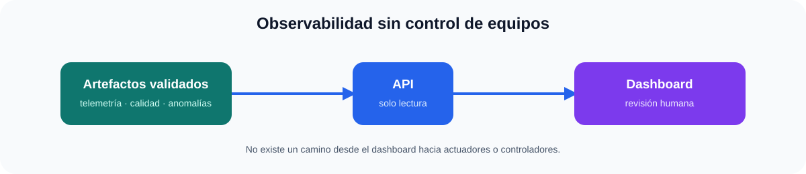

# FactoryPulse Dashboard

> Panel de operaciones de solo lectura para la plataforma de referencia FactoryPulse.

<p align="center"></p>

El dashboard muestra salud de activos, calidad del pipeline y anomalías explicables desde la API de FactoryPulse. Incluye una instantánea estática para revisar la interfaz sin infraestructura y puede conectarse a una API desplegada mediante `?api=https://tu-api.example`.

## Qué enseña

- Interfaz responsive para operaciones con un límite deliberado de solo lectura.
- Linaje de datos visible: ingesta → lakehouse → inteligencia → API → panel.
- Anomalías con motivo y puntuación, en lugar de alertas opacas.
- Despliegue estático sin claves API, cuentas ni backend oculto.

## Demo local reproducible

```bash
python -m http.server 8080 --directory dist
```

Abre `http://127.0.0.1:8080`. Para conectar una API compatible de FactoryPulse:

```text
http://127.0.0.1:8080/?api=http://127.0.0.1:8000
```

La versión publicada usa la instantánea de demostración incluida. Una API real requiere, antes de exponerla, autenticación, política CORS, control de acceso y revisión operativa.

## Límite de seguridad

Este panel no emite comandos a equipos ni es un sistema de control o de seguridad. Es una interfaz de observabilidad y revisión para una plataforma simulada de referencia.

## English summary

Read-only operations dashboard for the FactoryPulse reference platform. It visualises validated asset health, pipeline quality and explainable anomalies. The included static demo can be reviewed without infrastructure; a real API needs authentication and operational controls.
